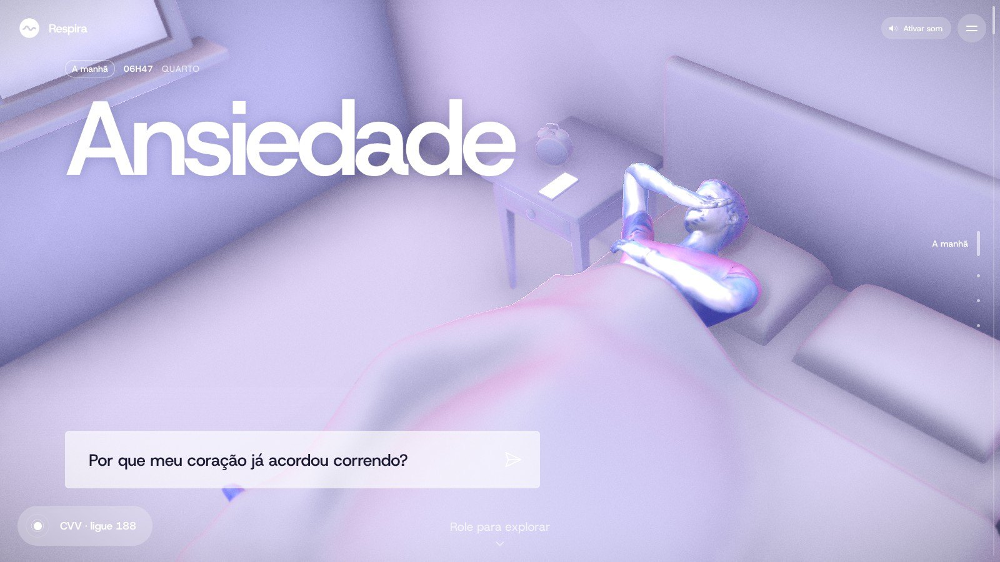
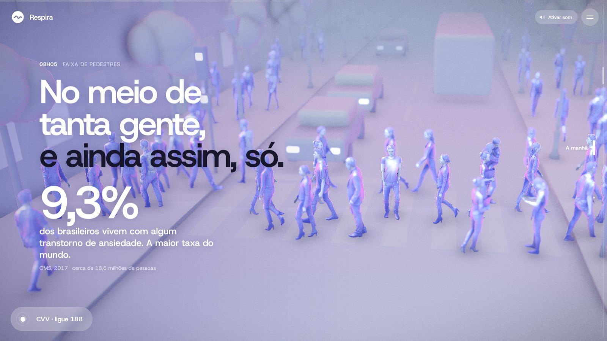

<div align="center">

<a href="https://dentro-da-ansiedade.vercel.app"></a>

# Dentro da Ansiedade

**Uma história interativa em 3D sobre como a ansiedade aparece, cresce e encontra saída.**

<a href="https://dentro-da-ansiedade.vercel.app"></a>


</div>

<br>

Site narrativo em 3D sobre ansiedade. A história avança com a rolagem, em 16 cenas e quatro atos (A manhã, O dia, A noite, A saída): um dia de alguém com ansiedade, do despertador até o pedido de ajuda. O protagonista não tem nome. O visual segue o estilo de [synthetic-humans.ai](https://synthetic-humans.ai/): pessoas escaneadas em azul lavanda, sem luz real, com borda rosada, pele de vidro, títulos enormes e desfoque de profundidade.

Feito com React 18, Vite 5, three.js e as bibliotecas `postprocessing` e `n8ao`.

<p align="center">
  
</p>

## Rodar

```bash
npm install
npm run dev       # http://localhost:5173
npm run build     # gera dist/, um site estático
npm run preview   # serve dist/ para conferir
```

O `vite.config.js` usa `base: './'`, então a pasta `dist/` funciona em qualquer subpasta ou hospedagem estática. Cada push na branch `main` publica o site na Vercel.

## Como funciona

- O React desenha só a camada de texto (`src/ui/`): títulos, conversas, notificações, números, a respiração guiada e os cartões de ajuda. A rolagem vira um número de cena (`store.progress`, de 0 a 15).
- O palco 3D (`src/v2/`) roda fora do React. `stage.js` monta cada cena uma vez, em segundo plano e na ordem da história, mostra a cena em que o leitor está, move a câmera dela conforme a rolagem e passa por uma cortina na cor da paleta entre uma cena e outra.
- Em telas largas a imagem desliza para a direita para abrir espaço para a coluna de texto; em telas em pé ela desce. O desfoque acompanha a câmera, e em máquinas lentas a resolução cai aos poucos.
- O coração do protagonista bate no ritmo de cada cena (`bpm`): o número de batimentos no canto e o brilho no peito dele seguem esse ritmo.
- Uma música de fundo original toca enquanto o leitor está no site: um piano calmo (68 BPM, em fá maior e ré menor) que dura 1min53 e emenda em si mesma sem corte, porque cada volta começa enquanto as últimas notas da anterior ainda soam (`src/audio/music.js`, arquivo `public/audio/respira.mp3`). O navegador só deixa tocar som depois de um clique, toque ou tecla: a música entra sozinha no primeiro deles, e o botão ao lado do menu liga e desliga (a escolha fica guardada no navegador). O arquivo só baixa depois que a cena carrega.
- Pular de capítulo pelo menu, pelas partes da história ou pela pílula do CVV faz uma passagem curta pela cor da cena de destino e chega lá direto, sem rolar por todas as cenas do meio. A barra de rolagem do navegador fica escondida e o site desenha a sua (`src/ui/Scrollbar.jsx`): dá para arrastar, e um clique na linha anda uma cena.
- A tela de carregamento mostra o protagonista em escultura escura (`public/loader-bust.webp`, renderizado do próprio modelo dele), o título, a marca e a porcentagem. A última cena leva, pequena no canto de baixo, a assinatura "Developed by Miguel Angelo" com a logo dele (`src/ui/Credit.jsx`). O ícone da aba é a marca da Respira (`public/favicon.svg`, que escurece ou clareia conforme o tema do navegador, mais `favicon.ico` e `apple-touch-icon.png`).
- `window.__dda` expõe o estado, quantas cenas já estão prontas e as batidas contadas, para testes e para a gravação de vídeo.
- A música foi composta em código, com o mesmo piano e a mesma sala do vídeo: a partitura está em `scripts/music/score.js` e as instruções para gerar o MP3 no topo de `scripts/music/render.mjs`.

## Onde mexer

| O que | Arquivo |
| --- | --- |
| Roteiro: lugar, hora, textos, conversas e movimento de câmera de cada cena | `src/v2/story.js` |
| Cenários: objetos, pessoas, poses, paleta, brilho e enquadramento de cada cena | `src/v2/scenes.js` |
| Movimentos de câmera, cortina entre cenas e coração e respiração no brilho do protagonista | `src/v2/stage.js` |
| Pessoas em movimento: ele andando no parque, a multidão na faixa e no final, gestos, acenos e respiração | `src/v2/motion.js` (gestos gravados em `public/v2/motion.json`) |
| Música de fundo e botão de som | `src/audio/music.js`, `src/ui/Chrome.jsx` |
| Tela de carregamento, barra de rolagem e assinatura | `src/ui/Preloader.jsx`, `src/ui/Scrollbar.jsx`, `src/ui/Credit.jsx` |
| Renderizador, efeitos (AO, desfoque, bloom, vinheta, granulado) e carregamento das pessoas | `src/v2/engine.js` |
| Paletas das cenas | `src/story.js` |
| Camada de texto | `src/ui/Overlay.jsx`, `src/ui/Chrome.jsx`, `src/styles.css` |
| Material das pessoas (AO, borda rosada, cetim, pele de vidro, dobras e cabelo do mapa de detalhe) | `src/three/personMaterial.js` |

## Pessoas, poses e objetos

- **Pessoas**: nove escaneamentos gratuitos da RenderPeople. Seis têm esqueleto (Claudia, Carla, Eric, Sophia, Nathan, Manuel) e três já vêm posados (Dennis de terno, Mei com uma pasta, Fabienne com o filho Percy). `scripts/bake/` calcula a oclusão ambiente e marca pele e cabelo nas cores de vértice; `npm run optimize` suaviza a pele e comprime (`public/models/`). `scripts/detail-maps.py` gera, a partir dos mapas 8K da RenderPeople, uma textura de detalhe por pessoa com o relevo das dobras e do cabelo (`public/detail/`, e `public/detail4k/` para o protagonista). As instruções para refazer estão no topo de cada script.
- **Poses**: vêm de capturas de movimento reais da CMU (sentar, deitar, andar, conversar), adaptadas ao esqueleto das pessoas e acertadas com cinemática inversa para cada cadeira, cama e mesa (`src/v2/posing.js` guarda as receitas). O resultado fica pronto em `public/v2/poses.json`, então o site não carrega capturas nem calcula nada: a primeira chamada `person()` de uma cena usa a primeira pose gravada daquela cena, a segunda usa a segunda, e assim por diante. Mudar a quantidade ou a ordem das pessoas de uma cena pede gravar as poses de novo.
- **Movimento**: `src/v2/motion.js` anima algumas cenas por cima das poses gravadas. Cada quadro é calculado só a partir do tempo desde que a cena apareceu (nada se acumula de um quadro para o outro e não há sorteio), então o vídeo pode ser gravado em partes e o site mostra sempre a mesma cena. O andar usa a captura `walk` do protagonista, com as pernas acompanhando a distância percorrida para os pés não deslizarem. Os gestos de mão (reunião, Carla, psicóloga) são poses-chave gravadas no laboratório por `scripts/lab/bake-motion.cjs`; ao gravar as poses de novo, grave os gestos também.
- **Objetos**: modelos da Poly Haven. `scripts/get-props.py` baixa os originais em `assets-src/props/` e `scripts/pack-props.mjs` gera os `.glb` leves em `public/props/` (texturas WebP de 512 px, malhas simplificadas e comprimidas).

## Créditos e cuidados

- Pessoas 3D: [RenderPeople, pessoas gratuitas](https://renderpeople.com/free-3d-people/). Elas têm licença própria. Confira os termos antes de publicar, principalmente sobre redistribuir os arquivos dos modelos.
- Captura de movimento: [CMU Graphics Lab Motion Capture Database](http://mocap.cs.cmu.edu/), criada com apoio da NSF (EIA-0196217), na conversão para BVH de Bruce Hahne.
- Objetos: [Poly Haven](https://polyhaven.com/models), licença CC0.
- Fonte: Host Grotesk (Google Fonts, licença OFL).
- Música: original, composta para o site.
- Dado da cena 4: Organização Mundial da Saúde, 2017 (9,3% da população brasileira com transtorno de ansiedade).
- Contatos de ajuda: CVV 188 (cvv.org.br), SAMU 192, CAPS e UBS pelo SUS.
- Licença: o código está sob a licença MIT (arquivo `LICENSE`). As pessoas em `public/models/`, `public/detail*/` e `assets-src/raw/` não entram nela, porque seguem a licença da RenderPeople.
- O site é informativo e não substitui acompanhamento profissional. Vale revisar os textos com alguém da área de saúde mental antes de divulgar.

---

<div align="center">

Feito por **Miguel Angelo** · [miguelrsant.com.br](https://miguelrsant.com.br) · [LinkedIn](https://www.linkedin.com/in/miguelrsant) · [GitHub](https://github.com/miguelrsant)

</div>
